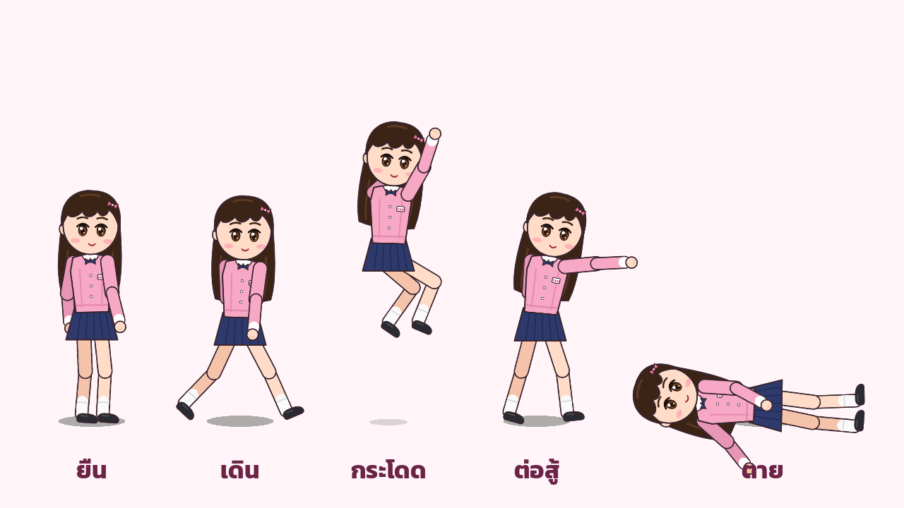
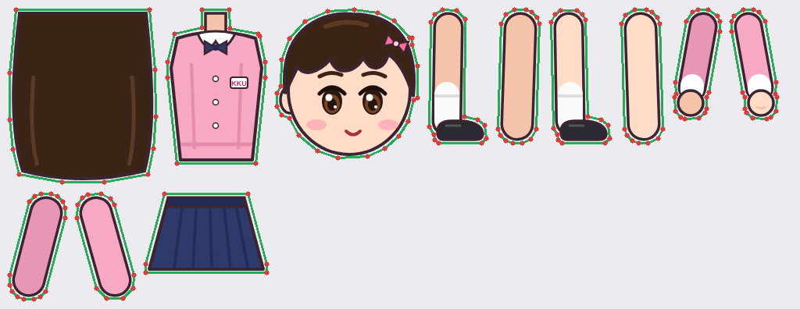
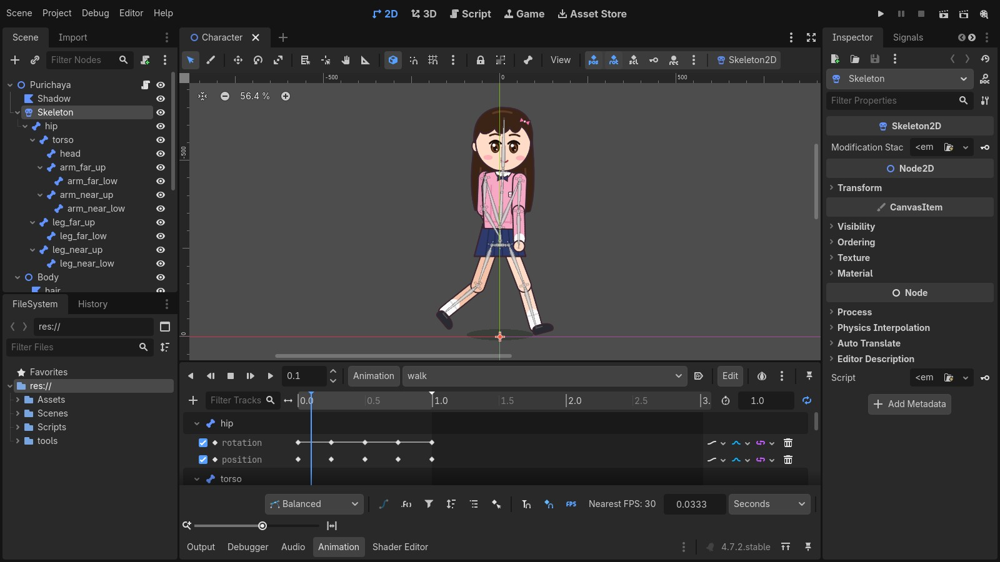
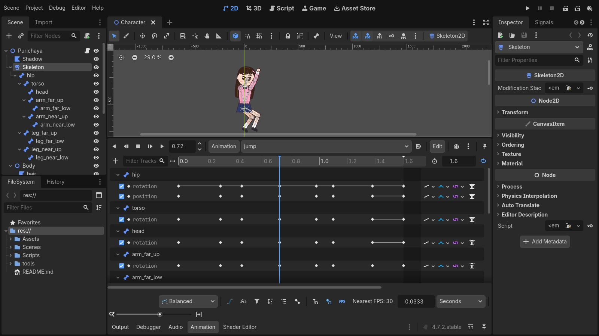

# Lab 7 (แบบฝึกหัดที่ 3) — ตัวละคร 2D แบบ Cutout / Skeletal Animation

**ภูริชญา โมรา · 673380636-9 · AI3 · Godot 4.7**

อ้างอิง: https://docs.godotengine.org/en/stable/tutorials/animation/2d_skeletons.html

- `Assets/Art/purichaya_sheet.png`: ชิ้นส่วนร่างกาย 12 ชิ้นของตัวละคร (การ์ตูนจากตัวนักศึกษา)
- `Scenes/Character.tscn`: Node2D → Skeleton2D (Bone2D 11 ชิ้น) + Body (Polygon2D 12 ชิ้น ผูก weight กับกระดูก) + AnimationPlayer
- ท่า (Keyframes + Cubic in-betweens): `idle` ยืน, `walk` เดิน, `jump` กระโดด, `punch` ต่อสู้, `die` ตาย
- `Scenes/Showcase.tscn`: 2D Scene แสดงทุกท่า เล่นอัตโนมัติ 60 วินาที

ปุ่ม: ←/→ เดิน • Space กระโดด • J ต่อย • K ตาย • 1–5 เลือกท่า • B แสดงกระดูก • G แกลเลอรี • Enter เล่นอัตโนมัติ

สร้างใหม่: `godot --headless -s tools/build_character.gd` แล้ว `godot --headless -s tools/build_showcase.gd`

## ผลงาน
- เล่นบนเว็บ: https://purichayam-dot.github.io/Lab7-2D-Skeleton/
- วิดีโอ 1 นาที: [media/Lab7_Purichaya_2D_Skeleton.mp4](media/Lab7_Purichaya_2D_Skeleton.mp4)

